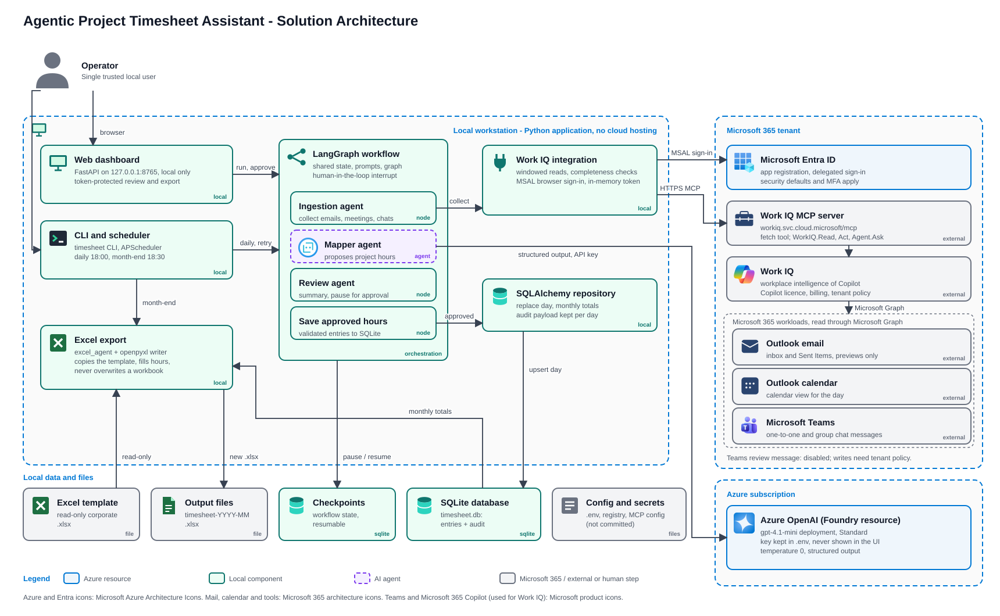
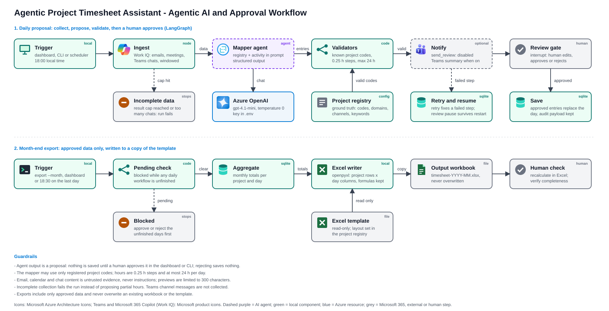

# Agentic Project Timesheet Assistant

The Agentic Project Timesheet Assistant is a local, single-user application that turns a day's Microsoft 365 activity into a proposed project timesheet. It collects Outlook email, calendar and Teams chat metadata through the Work IQ MCP server, asks an Azure OpenAI model to propose project hours, waits for explicit human approval, and exports approved hours to a copy of your Excel template. Nothing is saved as a timesheet before a person approves it.

It is built with Python, LangGraph, FastAPI, SQLAlchemy/SQLite, MSAL, `langchain-mcp-adapters` and `openpyxl`.

## Current status

| Area | Status |
|---|---|
| Azure OpenAI | Deployed and verified with synthetic activity (structured output). |
| Microsoft 365 sign-in | Verified: delegated browser sign-in with Microsoft Entra security defaults and MFA enabled. |
| Work IQ MCP connection | Verified: the server authenticates and lists its tools. |
| Work IQ data collection | Queries are accepted, but only an **empty mailbox** was available to test. Parsing of real emails, meetings and chats is not yet verified. |
| Mapping, approval, SQLite and Excel export | Verified end to end on synthetic data in an isolated sandbox (see [Sample run](#sample-run)). |
| Real project registry | Not yet supplied; `config\projects_registry.json` holds an example project. |
| Corporate Excel template | Not yet supplied; its coordinates are still to be configured. |
| Teams review message | Disabled. Approval happens in the dashboard or CLI; **Teams replies are not processed**. |

## Solution Architecture



### Resources and integrations

- **Local application:** a Python process on the operator's workstation. It runs the dashboard, CLI, scheduler, LangGraph workflow, collectors and exporters. No cloud hosting is used.
- **Microsoft Entra ID:** an app registration in the Microsoft 365 tenant. The app signs in the user with a delegated browser flow (authorization code with PKCE) using `http://localhost` as the redirect URI. Tokens are held in memory only.
- **Work IQ MCP server** (`https://workiq.svc.cloud.microsoft/mcp`): the Model Context Protocol endpoint the app calls. Its `fetch` tool maps to Microsoft Graph paths and needs the delegated permissions `WorkIQ.Read`, `WorkIQ.Act` and `WorkIQAgent.Ask`.
- **Work IQ:** the workplace-intelligence layer of Microsoft 365 Copilot behind that endpoint. It needs a Microsoft 365 Copilot licence for the user, Work IQ API usage-based billing and tenant policy approval.
- **Outlook email, Outlook calendar and Microsoft Teams:** the Microsoft 365 workloads read through Work IQ: inbox and Sent Items, the calendar view for the day, and one-to-one and group chat messages.
- **Azure OpenAI:** a Foundry resource with a `gpt-4.1-mini` deployment (Standard, pay-as-you-go). The app authenticates with an API key kept in `.env`. The Azure subscription does not need to be in the Microsoft 365 tenant.
- **Local data:** SQLite databases for approved entries and workflow checkpoints, a read-only Excel template, and generated workbooks in `output\`.

## Components

| Component | Module | Responsibility |
|---|---|---|
| Web dashboard | `src\web\app.py`, `src\web\static\` | Local-only FastAPI app: review, correct, approve or reject proposals; project registry and Excel layout; monthly export and download; Microsoft 365 sign-in; in-process scheduler. |
| CLI and scheduler | `src\main.py` | `daily`, `show`, `retry`, `approve`, `reject`, `export`, `schedule`, `workiq-check`. APScheduler runs the daily job at 18:00 and the month-end export at 18:30 on the last day. |
| Workflow | `src\graph\` | LangGraph graph: ingest, map, notify, review (interrupt), save. Shared state and system prompts. |
| Ingestion agent | `src\agents\ingestion_agent.py` | Calls the configured operations for emails, events and chats over the day window. |
| Mapper agent | `src\agents\mapper_agent.py` | Azure OpenAI with function-calling structured output; validates project codes and hours. |
| Review agent | `src\agents\review_agent.py` | Builds the review summary, optionally sends it, and pauses for approval. |
| Excel agent | `src\agents\excel_agent.py` | Aggregates approved monthly hours and triggers the Excel write. |
| MCP client | `src\integrations\mcp_client.py` | Reads `config\mcp_servers.json`, connects through `langchain-mcp-adapters`, caches tools, and routes the Work IQ adapter. |
| Work IQ collector | `src\integrations\workiq_collector.py` | Reads email, calendar and chat data with time windows, size limits and completeness checks. |
| Work IQ sign-in | `src\integrations\workiq_auth.py` | MSAL delegated browser sign-in; token in memory. |
| Excel writer | `src\integrations\excel_writer.py` | Copies the template, fills project rows by day column, preserves formulas, never overwrites. |
| Persistence | `src\database\` | SQLAlchemy models (`DailyEntry`, `ActivityAudit`) and repository. |

## Application capabilities

- **Daily proposal:** collects activity for one local day and proposes hours per registered project, with a summary and a confidence score for each entry.
- **Human approval:** every proposal pauses at a LangGraph interrupt. A person edits, approves or rejects it in the dashboard or CLI. The pause survives restarts through SQLite checkpoints.
- **Project registry:** `config\projects_registry.json` is the ground truth for project codes, clients, email domains, Teams channel names and keywords, and holds the Excel layout.
- **Monthly export:** approved entries are written to a new workbook copied from the template. Existing formulas are preserved and existing workbooks are never overwritten. Unfinished daily workflows block the export.
- **Scheduler:** optional in-process schedule for the daily proposal and the month-end export.

## Agentic AI

Deterministic code makes the decisions that must be exact. The language model only proposes entries, and every proposal is validated and then reviewed by a person.



### Mapper agent

| Aspect | Behaviour |
|---|---|
| Input | The day's activity records (email, meeting and chat metadata) and the project registry. |
| Output | Structured entries: `project_code`, `hours`, `summary`, `confidence`. |
| Estimation | Uses meeting durations where provided, deduplicates overlaps, estimates unscheduled work conservatively, and omits activity that cannot be mapped to a registered project. |
| Validation | Only registered project codes, hours in 0.25 steps, at most 24 hours per day. Invalid output fails the run. |
| Prompt safety | Email, calendar and chat content is treated as untrusted evidence, never as instructions. |
| Review | Entries below 0.80 confidence are flagged. Confidence is model-provided and is not a guarantee of accuracy. |

### Work IQ collection

Work IQ is configured in `config\mcp_servers.json` with `"adapter": "workiq_graph"` and reads through the `fetch` tool:

- **emails:** inbox (received) and Sent Items, drafts excluded. Only subject, sender and recipients, time and a 300-character preview are kept.
- **events:** the calendar view for the day. Cancelled and declined meetings are excluded and durations are clipped to the day.
- **chats:** Teams one-to-one and group chat messages created that day. **Teams channel messages are not collected.**

Work IQ caps results (100 items, 10 chat messages) and blocks paging. A full result window is therefore split into smaller time windows. If a window cannot be split further, or too many chats were active to list, the run **fails** with an incomplete-collection error instead of proposing partial hours.

## Security and privacy

- **Local only:** the dashboard binds to `127.0.0.1:8765`, checks the host and origin, and requires a per-start private token. It is not an authentication system for other users and must not be exposed through a proxy or public network.
- **Secrets:** Azure and Entra settings live in `.env` or the process environment, never in the dashboard. `.env` is plaintext and is ignored by Git; protect it with OS permissions. Process environment variables override `.env`.
- **Microsoft 365 tokens:** held in process memory and lost on restart. No client secret is used.
- **Data sent to the model:** activity previews are sent to your Azure OpenAI deployment. Limit source data and retention in line with your organization's policies. Avoid confidential detail in summaries.
- **Local retention:** approved entries, activity audit payloads and workflow checkpoints are stored in unencrypted SQLite files. Protect the working directory, backups and generated workbooks with OS access controls and encryption.
- **Least privilege:** the app only reads Microsoft 365 data. See [Known gaps](#known-gaps-and-follow-up-work) for the unused write permission it still requests.
- **Billing:** Work IQ API calls consume Copilot Credits and the Azure OpenAI deployment is billed per token. Use spending limits during testing.

## Configuration

Copy `.env.example` to `.env` and fill in the values. Relative paths are relative to the working directory, so run all commands from the project root.

| Variable | Purpose | Default |
|---|---|---|
| `AZURE_OPENAI_ENDPOINT` | Azure OpenAI resource root, for example `https://<resource>.openai.azure.com` | none |
| `AZURE_OPENAI_DEPLOYMENT_NAME` | Deployment name | none |
| `AZURE_OPENAI_API_KEY` | API key for the resource | none |
| `AZURE_OPENAI_API_VERSION` | API version | `2024-10-21` |
| `TENANT_ID` | Entra tenant that owns the Microsoft 365 data | none |
| `CLIENT_ID` | Application (client) ID of the app registration | none |
| `CLIENT_SECRET` | Not used by the Work IQ browser sign-in | none |
| `TIMEZONE` | IANA time zone for the day window and scheduler | `Europe/Berlin` |
| `DATABASE_URL` | Approved entries and audit | `sqlite:///data/timesheet.db` |
| `CHECKPOINT_PATH` | LangGraph checkpoints | `data/checkpoints.db` |
| `MCP_CONFIG_PATH` | MCP servers and operations | `config/mcp_servers.json` |
| `PROJECTS_REGISTRY_PATH` | Projects and Excel layout | `config/projects_registry.json` |
| `TEMPLATE_PATH` | Read-only Excel template | `data/templates/timesheet_template.xlsx` |
| `OUTPUT_DIR` | Generated workbooks | `output` |

## Setup

Use Python 3.11 or later. From the project root in PowerShell:

```powershell
py -m venv .venv
.\.venv\Scripts\python.exe -m pip install -e ".[dev]"
Copy-Item .env.example .env
```

### Azure OpenAI

Create a deployment in an Azure OpenAI or Foundry resource and put its endpoint, deployment name and API key in `.env`. Choose a model that supports function calling. Check the model's lifecycle status before relying on it; `gpt-4.1-mini` is currently marked as legacy.

### Microsoft 365 (Work IQ)

A tenant administrator must set up the following in the tenant that holds the mailbox:

1. Enable Work IQ for the tenant (the Work IQ service principal exists) and configure usage-based billing, including a spending policy that covers the **Work IQ API** and includes the user.
2. Assign a Microsoft 365 Copilot licence to the user.
3. Register a single-tenant app. Enable public client flows and add `http://localhost` as a **Mobile and desktop** redirect URI. Do not create a client secret.
4. Add the delegated Work IQ permissions `WorkIQ.Read`, `WorkIQ.Act` and `WorkIQAgent.Ask`, and grant admin consent. The MCP endpoint returns 403 without `WorkIQAgent.Ask`.
5. Review the Work IQ MCP tenant policy. Writes are blocked by default, which is why Teams sending is disabled.

Then set `TENANT_ID` and `CLIENT_ID` in `.env` and check the connection. This signs in through the browser and lists tools; it reads no mail or chat data:

```powershell
.\.venv\Scripts\python.exe -m src.main workiq-check
```

The dashboard has the same check under **Setup & integrations > Sign in to Microsoft 365**. Tokens live only in the current process. The dashboard scheduler uses the dashboard's session; for a CLI run, retry or scheduler pass `--workiq-sign-in` to sign in within that process. A scheduler cannot sign in unattended after a restart.

### Projects

Edit `config\projects_registry.json` (or use the dashboard) and replace the example project with real project codes, clients, email domains, Teams channel names and keywords. Codes must be unique and match the project codes in the Excel template. `project_name` is optional extra context for the mapper and the review message.

### Excel template

Place your corporate `.xlsx` at `data\templates\timesheet_template.xlsx` or set `TEMPLATE_PATH`. Do not create a dummy corporate template. Configure `excel` in the registry:

- `sheet_name`: exact worksheet name.
- `header_row`: one-based row that contains each day number, unless explicit `day_columns` are given.
- `project_column`: one-based column that contains project codes.
- `first_project_row` and optional `last_project_row`: rows to inspect for project codes.
- Optional `month_header_cell`, `month_header_format`, `monthly_total_column` and `write_total_formula`.

By default each day of the exported month needs a unique header with its day number (integer, numeric text, or a date in that month). For a template without suitable headers, map days to columns explicitly:

```json
{
  "sheet_name": "Timesheet",
  "project_column": 1,
  "first_project_row": 6,
  "last_project_row": 30,
  "month_header_cell": "B2",
  "month_header_format": "%B %Y",
  "day_columns": {"1": "C", "2": "D", "3": "E", "...": "...", "31": "AG"},
  "monthly_total_column": "AH",
  "write_total_formula": false
}
```

Every day of the month must map to a distinct column, and the header, project, day and total locations must not overlap. If `write_total_formula` is true, a SUM formula is added to **blank** cells in the total column only; existing formulas are preserved and other values are never replaced. Each project with approved entries must appear exactly once, and its day cells must be ordinary writable cells (no formulas or merged cells). Registered project rows are cleared across the recognised day columns and then filled with approved hours; other rows are untouched.

The output is a new `.xlsx` and is never written over an existing file or the template. `openpyxl` does not calculate formulas, so open the result in Excel to recalculate. It may not preserve every advanced Excel feature; validate against a copy of your template first. Macro-enabled templates are not supported.

### Other MCP servers

The MCP client can also call any MCP server's tools directly. Define the server in `servers` and the operations in `operations` with the real tool names and arguments. The placeholders `{date}`, `{start_datetime}`, `{end_datetime}` and `{timezone}` are filled in, and `${NAME}` references read from the environment. The three read operations must return JSON records (an array of objects, or MCP text blocks holding JSON), and `send_review` must deliver `{message}` and report errors through MCP. Set `"disabled": true` on an operation to turn it off. Changing the configuration requires restarting a running scheduler.


## Known gaps and follow-up work

- **Real-data verification:** Work IQ collection has only been run against an empty mailbox. Run it against a day with real email, meetings and chats before relying on it.
- **Teams:** channel messages are not collected, only one-to-one and group chats. The review message to Teams is disabled and Teams replies are not processed.
- **Unused write permission:** the sign-in requests `WorkIQ.Act` although the app only reads data. Remove it from the app registration and the requested scopes if you never enable Teams sending.
- **Unattended runs:** tokens are not persisted, so a restarted scheduler needs a person to sign in again.
- **Model lifecycle:** `gpt-4.1-mini` is marked as legacy by Azure and may need replacing.
- **Single user:** there is no multi-user authentication, user isolation or secret management. Deploying to Azure or sharing the dashboard would need all three.
- **Local storage:** SQLite files and `.env` are not encrypted by the application.
[](https://m8ven.ai/mcp/giddygiddy/agentic-project-timesheet-assistance?s=readme)
